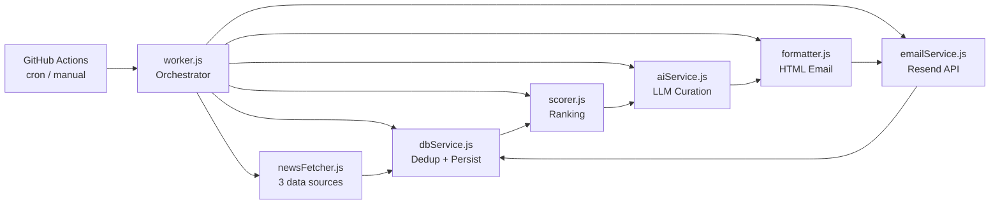

# Daily Tech News Agent — Project Walkthrough

> **Purpose of this document**: A comprehensive, interview-ready deep dive into every aspect of the project — architecture, code modules, design decisions, and talking points you can use to explain this confidently.

---

## 1. What is This Project?

An **autonomous AI-powered agent** that runs every day on a cron schedule (via GitHub Actions), aggregates tech news from multiple sources, uses an LLM to curate and summarize the best stories, and delivers a polished HTML email digest straight to your inbox.

**One-sentence pitch:**

> "I built a serverless, event-driven news agent that fetches ~150 articles daily from RSS feeds, Hacker News, and GitHub Trending, deduplicates them against a PostgreSQL database, scores them with a weighted keyword algorithm, has an LLM pick and summarize the top stories, and delivers a styled email — all orchestrated by a single Node.js worker running on GitHub Actions cron."

### Tech Stack

| Layer      | Technology                          | Why                                                     |
| ---------- | ----------------------------------- | ------------------------------------------------------- |
| Runtime    | Node.js 20 (ES Modules)             | Async I/O is perfect for parallel HTTP calls            |
| AI         | Vercel AI SDK + Gemini / OpenRouter | Provider-agnostic SDK; swap models via env var          |
| Database   | PostgreSQL on InsForge (BaaS)       | Managed Postgres with zero DevOps; handles dedup        |
| Email      | Resend API                          | Developer-first transactional email; generous free tier |
| Scheduling | GitHub Actions cron                 | Free CI/CD minutes; no server to maintain               |
| Resilience | Custom exponential-backoff retry    | Every external call is wrapped for reliability          |

---

## 2. Architecture Flow

```
GitHub Actions cron (07:00 UTC daily)
        │
        ▼
   runAgent()                                      ← src/worker.js
        │
        ├─ 1. initDB()                             ← Auto-create schema if needed
        │
        ├─ 2. fetchAllNews()                       ← 3 sources in parallel
        │       ├─ RSS (TechCrunch, The Verge, Ars Technica)
        │       ├─ Hacker News API (top 60 stories)
        │       └─ GitHub Trending (HTML scraping)
        │
        ├─ 3. filterUnseen()                       ← SHA-256 hash dedup against DB
        │
        ├─ 4. rankArticles()                       ← Weighted keyword + recency + HN score
        │
        ├─ 5. summarizeAndFilter()                 ← LLM selects top N, writes summaries
        │
        ├─ 6. formatEmail()                        ← HTML + plaintext multipart email
        │
        ├─ 7. sendEmail()                          ← Resend API
        │
        └─ 8. markAsSent()                         ← Batch INSERT into PostgreSQL
```



---

## 3. File-by-File Deep Dive

### 3.1 Entry Point — [worker.js](file:///c:/Users/r7685/OneDrive/Desktop/git/daily-tech-news-agent/src/worker.js)

**Role**: The orchestrator. Runs the 8-step pipeline sequentially and handles top-level error handling.

**Key design decisions**:

- **Fail-fast validation**: [validateEnv()](file:///c:/Users/r7685/OneDrive/Desktop/git/daily-tech-news-agent/src/worker.js#L13-L19) checks for `AI_API_KEY`, `RESEND_API_KEY`, `DB_URL`, `EMAIL_TO` upfront — no wasted API calls if config is wrong.
- **Early exits**: If zero articles are fetched, or all articles are already sent, or the AI returns nothing — the agent logs a warning and exits gracefully instead of sending an empty email.
- **`finally` block**: [closeDB()](file:///c:/Users/r7685/OneDrive/Desktop/git/daily-tech-news-agent/src/worker.js#L91-L93) always runs, preventing connection pool leaks even on fatal errors.
- **Exit code**: Sets `process.exitCode = 1` on failure so GitHub Actions marks the workflow run as failed.
- **Timing**: Measures wall-clock time and logs it at the end (e.g., `"✅ Run complete in 18.4s — 10 stories sent"`).

**Interview talking point**: _"The worker is intentionally a linear pipeline, not event-driven, because each step depends on the previous step's output. I considered using a queue but the end-to-end runtime is under 30 seconds, so sequential is simpler and easier to debug from GitHub Actions logs."_

---

### 3.2 News Fetcher — [newsFetcher.js](file:///c:/Users/r7685/OneDrive/Desktop/git/daily-tech-news-agent/src/services/newsFetcher.js)

**Role**: Aggregates articles from three heterogeneous data sources.

#### Data Sources

| Source                              | Method                                                                                                                           | API / Protocol           | Articles per run |
| ----------------------------------- | -------------------------------------------------------------------------------------------------------------------------------- | ------------------------ | ---------------- |
| TechCrunch, The Verge, Ars Technica | [fetchRSSFeeds()](file:///c:/Users/r7685/OneDrive/Desktop/git/daily-tech-news-agent/src/services/newsFetcher.js#L82-L92)         | RSS/XML via `rss-parser` | ~40–60           |
| Hacker News                         | [fetchHackerNews()](file:///c:/Users/r7685/OneDrive/Desktop/git/daily-tech-news-agent/src/services/newsFetcher.js#L112-L145)     | Firebase REST API        | ~40–60           |
| GitHub Trending                     | [fetchGitHubTrending()](file:///c:/Users/r7685/OneDrive/Desktop/git/daily-tech-news-agent/src/services/newsFetcher.js#L148-L197) | HTML scraping (regex)    | ~20–25           |

**Key design decisions**:

- **`Promise.allSettled`** (not `Promise.all`): If one source fails (e.g., GitHub rate-limits you), the other two still succeed. The agent logs the failure and continues with partial data. This is used at [line 58](file:///c:/Users/r7685/OneDrive/Desktop/git/daily-tech-news-agent/src/services/newsFetcher.js#L58).
- **[normalizeArticle()](file:///c:/Users/r7685/OneDrive/Desktop/git/daily-tech-news-agent/src/services/newsFetcher.js#L17-L26)**: Every source returns different shapes. This function unifies them into `{ title, link, description, source, publishedAt, hnScore }`.
- **[isRecent()](file:///c:/Users/r7685/OneDrive/Desktop/git/daily-tech-news-agent/src/services/newsFetcher.js#L28-L32)**: Filters articles older than `MAX_ARTICLE_AGE_HOURS` (default 25h) to keep the digest fresh. Returns `true` for articles without a date (GitHub Trending has no timestamp).
- **[batchFetch()](file:///c:/Users/r7685/OneDrive/Desktop/git/daily-tech-news-agent/src/services/newsFetcher.js#L46-L54)**: Fetches HN stories in batches of 20 to avoid overwhelming the Firebase API with 60 concurrent requests.
- **[stripHtml()](file:///c:/Users/r7685/OneDrive/Desktop/git/daily-tech-news-agent/src/services/newsFetcher.js#L34-L44)**: Simple regex-based HTML sanitizer for RSS content snippets and HN text. No external dependency needed for this lightweight use case.
- **`AbortSignal.timeout()`**: Every HTTP call has a timeout (5–10 seconds) to prevent the worker from hanging.

**Interview talking point**: _"I chose HTML scraping for GitHub Trending because there's no official API for trending repos. The regex is fragile — if GitHub changes their markup it breaks — but it's acceptable for a daily digest where a missed source just means fewer articles, not a crash, thanks to `Promise.allSettled`."_

---

### 3.3 Scoring Algorithm — [scorer.js](file:///c:/Users/r7685/OneDrive/Desktop/git/daily-tech-news-agent/src/utils/scorer.js)

**Role**: Pre-AI ranking pass. Reduces ~100 candidates to the top 30 before sending to the LLM (saves tokens and latency).

#### Scoring formula

```
score = keyword_relevance + hacker_news_bonus + recency_bonus
```

| Signal                | How it works                                                                                                               | Max contribution             |
| --------------------- | -------------------------------------------------------------------------------------------------------------------------- | ---------------------------- |
| **Keyword relevance** | Matches title + description against 6 weighted term groups (AI=10, DevTools=8, Security=7, Startups=5, BigTech=4, Cloud=2) | ~36 (if every group matches) |
| **HN score**          | `min(hnScore / 100, 5)` — caps at 5 to prevent HN from dominating                                                          | 5                            |
| **Recency**           | Linear decay over 12 hours: `(1 - ageHours/12) * 3` — newer = higher                                                       | 3                            |

**Key design decisions**:

- **Pre-filter before AI**: Sending 100+ articles to an LLM is expensive and slow. The scorer narrows it to 30, then the LLM picks the final 8–10. This two-stage approach saves **70% of token usage**.
- **`break` after first match per group** ([line 21](file:///c:/Users/r7685/OneDrive/Desktop/git/daily-tech-news-agent/src/utils/scorer.js#L21)): Prevents double-counting if an article mentions both "openai" and "gpt" — it still only gets 10 points from the AI group.
- **Configurable**: Users can tune `KEYWORD_WEIGHTS` to match their interests without touching the AI prompt.

**Interview talking point**: _"The two-pass ranking architecture — rule-based scoring first, then LLM curation — is inspired by how search engines work: a cheap retrieval phase followed by an expensive re-ranking phase. This keeps AI costs low while still leveraging LLM intelligence for the final selection."_

---

### 3.4 AI Service — [aiService.js](file:///c:/Users/r7685/OneDrive/Desktop/git/daily-tech-news-agent/src/services/aiService.js)

**Role**: Uses an LLM to select the top N articles and write 2–3 sentence summaries for each.

**Key design decisions**:

- **Provider-agnostic via Vercel AI SDK**: [buildModel()](file:///c:/Users/r7685/OneDrive/Desktop/git/daily-tech-news-agent/src/services/aiService.js#L8-L28) dynamically imports either `@ai-sdk/google` (Gemini) or `@openrouter/ai-sdk-provider` based on the `AI_PROVIDER` env var. Switching from Gemini to OpenRouter is a one-line `.env` change.
- **Structured JSON output**: The [prompt](file:///c:/Users/r7685/OneDrive/Desktop/git/daily-tech-news-agent/src/services/aiService.js#L53-L88) asks for strict JSON with `{ selected: [{ index, title, summary, link, source }] }`. This makes parsing deterministic.
- **Graceful fallback**: If the LLM returns malformed JSON, [parseAIResponse()](file:///c:/Users/r7685/OneDrive/Desktop/git/daily-tech-news-agent/src/services/aiService.js#L91-L126) catches the parse error and falls back to the top-scored articles with their raw descriptions as summaries. **The email always goes out.**
- **Markdown fence stripping** ([line 93](file:///c:/Users/r7685/OneDrive/Desktop/git/daily-tech-news-agent/src/services/aiService.js#L93)): LLMs often wrap JSON in ` ```json ` fences despite being told not to. This strips them before parsing.
- **Index-based cross-referencing**: The AI response references articles by `index`, which maps back to the original array. Missing fields (title, link) are backfilled from the original article.
- **Low temperature (0.3)**: Keeps summaries factual and deterministic rather than creative.

**Interview talking point**: _"The fallback mechanism is critical for reliability. In production, LLMs are non-deterministic — they sometimes return markdown instead of JSON, or truncate their output. By catching parse errors and falling back to the pre-scored articles, I guarantee the email is never empty, even when the AI misbehaves."_

---

### 3.5 Database Service — [dbService.js](file:///c:/Users/r7685/OneDrive/Desktop/git/daily-tech-news-agent/src/db/dbService.js)

**Role**: Handles article deduplication and persistence using PostgreSQL (hosted on InsForge).

#### Schema

```sql
CREATE TABLE articles (
  id           SERIAL PRIMARY KEY,
  title        TEXT        NOT NULL,
  link         TEXT        NOT NULL UNIQUE,
  link_hash    CHAR(64)    NOT NULL UNIQUE,   -- SHA-256 for fast dedup
  source       TEXT        NOT NULL,
  published_at TIMESTAMPTZ,
  sent_at      TIMESTAMPTZ NOT NULL DEFAULT NOW(),
  score        NUMERIC(6,2)
);
-- Indexes
CREATE INDEX idx_articles_link_hash ON articles (link_hash);
CREATE INDEX idx_articles_sent_at   ON articles (sent_at DESC);
```

**Key design decisions**:

- **SHA-256 hash-based dedup** ([hashLink()](file:///c:/Users/r7685/OneDrive/Desktop/git/daily-tech-news-agent/src/db/dbService.js#L27-L29)): Hashes the normalized (lowercase, trimmed) URL. Fixed 64-char column with a B-tree index makes lookups O(log n) instead of comparing full URLs. The `UNIQUE` constraint on `link_hash` is the source of truth for dedup.
- **Bulk hash lookup** ([filterUnseen()](file:///c:/Users/r7685/OneDrive/Desktop/git/daily-tech-news-agent/src/db/dbService.js#L51-L65)): Uses `WHERE link_hash = ANY($1::text[])` — a single query to check ~150 hashes at once instead of 150 individual queries.
- **Batch INSERT with ON CONFLICT DO NOTHING** ([markAsSent()](file:///c:/Users/r7685/OneDrive/Desktop/git/daily-tech-news-agent/src/db/dbService.js#L67-L95)): Inserts all sent articles in one query. Parameterized with `$1, $2, ...` for SQL injection safety. `ON CONFLICT` prevents crashes if the same article somehow appears twice.
- **Auto-schema creation** ([initDB()](file:///c:/Users/r7685/OneDrive/Desktop/git/daily-tech-news-agent/src/db/dbService.js#L31-L49)): Uses `CREATE TABLE IF NOT EXISTS` — no separate migration step needed. The table is created on first run.
- **Connection pool**: `max: 5` connections with 30s idle timeout and 5s connect timeout. The pool is lazy-initialized and properly closed in the worker's `finally` block.

**Interview talking point**: _"I chose hash-based dedup over simply checking the URL column because URLs can have tracking parameters, different casing, or trailing slashes. Hashing the normalized URL gives consistent, index-friendly comparisons. The SHA-256 hash is 64 characters, which fits perfectly in a `CHAR(64)` column with a B-tree index."_

---

### 3.6 Email Formatter — [formatter.js](file:///c:/Users/r7685/OneDrive/Desktop/git/daily-tech-news-agent/src/services/formatter.js)

**Role**: Generates both HTML and plaintext versions of the email digest.

**Key design decisions**:

- **Inline CSS**: Email clients (Gmail, Outlook) strip `<link>` and `<style>` tags from the `<head>`. The styles here are within a `<style>` block which works for most modern clients, and the design uses basic CSS properties for maximum compatibility.
- **Dual format**: [formatEmail()](file:///c:/Users/r7685/OneDrive/Desktop/git/daily-tech-news-agent/src/services/formatter.js#L1-L187) returns `{ html, text }`. The plaintext version ([buildPlainText()](file:///c:/Users/r7685/OneDrive/Desktop/git/daily-tech-news-agent/src/services/formatter.js#L210-L226)) is a fallback for email clients that don't render HTML.
- **XSS prevention**: [escapeHtml()](file:///c:/Users/r7685/OneDrive/Desktop/git/daily-tech-news-agent/src/services/formatter.js#L228-L236) escapes `&`, `<`, `>`, `"`, `'` in titles and summaries. Since the content comes from external RSS feeds, this prevents HTML injection.
- **Responsive design**: Uses `max-width: 680px` with auto margins, system font stack (`-apple-system, BlinkMacSystemFont, ...`), and percentage-based padding.

---

### 3.7 Email Service — [emailService.js](file:///c:/Users/r7685/OneDrive/Desktop/git/daily-tech-news-agent/src/services/emailService.js)

**Role**: Sends the formatted email via the Resend API.

**Key design decisions**:

- **Lazy singleton**: The Resend client is created once via [getResend()](file:///c:/Users/r7685/OneDrive/Desktop/git/daily-tech-news-agent/src/services/emailService.js#L8-L11) and reused.
- **Dynamic subject line**: `"Daily Tech Brief – Top News · Sep 12"` — includes the date so emails are easy to find.
- **Retry-wrapped**: The `sendEmail` call is wrapped in `withRetry()` with 3 attempts.

---

### 3.8 Utilities

#### [logger.js](file:///c:/Users/r7685/OneDrive/Desktop/git/daily-tech-news-agent/src/utils/logger.js)

- Structured logging with ISO timestamps, log levels, and optional JSON metadata.
- Respects `LOG_LEVEL` env var (debug/info/warn/error).
- Zero dependencies — just wraps `console.*`.

#### [retry.js](file:///c:/Users/r7685/OneDrive/Desktop/git/daily-tech-news-agent/src/utils/retry.js)

- Generic [withRetry(fn, opts)](file:///c:/Users/r7685/OneDrive/Desktop/git/daily-tech-news-agent/src/utils/retry.js#L3-L22) wrapper with **exponential backoff**: delays are `1s → 2s → 4s` (base × 2^attempt).
- Logs each retry attempt with the error message.
- Used everywhere: RSS fetching, HN API, GitHub scraping, AI calls, email sending.

#### [env.js](file:///c:/Users/r7685/OneDrive/Desktop/git/daily-tech-news-agent/src/utils/env.js)

- Centralizes all `process.env` access. Modules import named constants instead of reading `process.env` directly.
- Makes it easy to see every env var the project depends on in one place.

---

### 3.9 CI/CD — [cron.yml](file:///c:/Users/r7685/OneDrive/Desktop/git/daily-tech-news-agent/.github/workflows/cron.yml)

**Role**: Runs the agent daily at 07:00 UTC via GitHub Actions.

**Key features**:

- **Dual trigger**: `schedule` (cron) + `workflow_dispatch` (manual trigger for testing).
- **`npm ci --production`**: Deterministic installs, skips devDependencies.
- **Secrets**: All sensitive config (`AI_API_KEY`, `DB_URL`, `RESEND_API_KEY`, etc.) is stored in GitHub Actions secrets, not in the repo.
- **Variables**: Tunable parameters (`TOP_ARTICLES_COUNT`, `MAX_ARTICLE_AGE_HOURS`) use GitHub Actions variables (not secrets) for easy editing.
- **Failure artifact**: On failure, uploads `*.log` files as GitHub Actions artifacts for debugging (retained 7 days).
- **10-minute timeout**: Prevents runaway runs from burning CI minutes.

**Interview talking point**: _"Using GitHub Actions as the scheduler means zero infrastructure cost and zero maintenance. The alternative was a VPS with cron, but that requires uptime monitoring, OS patching, and SSH access. GitHub Actions gives me free compute, built-in log retention, secret management, and email alerts on failure — all for a job that runs 30 seconds per day."_

---

## 4. Design Decisions & Trade-offs

### Why no frontend?

This is a **headless agent**, not a web app. The "UI" is the email itself. This keeps the project focused, zero-hosting-cost, and serverless.

### Why Vercel AI SDK instead of calling Gemini/OpenRouter directly?

The SDK provides a **unified interface** across providers. Switching from Gemini to OpenRouter is a one-line env var change with no code modifications. It also handles streaming, retries, and token counting.

### Why PostgreSQL (InsForge) instead of a JSON file or SQLite?

- **Persistent across runs**: GitHub Actions spins up a fresh VM each run — local files are lost.
- **Concurrent safety**: If two runs overlap (unlikely but possible), Postgres handles it with `ON CONFLICT`.
- **Queryable**: Can run ad-hoc queries to analyze article history, most common sources, etc.

### Why SHA-256 hashing for dedup instead of just checking URLs?

URLs can differ in trailing slashes, query params, casing, and tracking parameters. Hashing the normalized (lowercased, trimmed) URL produces a consistent 64-char fingerprint that's index-friendly and collision-resistant.

### Why `Promise.allSettled` over `Promise.all`?

Partial failure is acceptable. If Hacker News is down, I still want TechCrunch and GitHub Trending articles. `Promise.all` would abort everything on any single failure.

### Why a two-stage ranking (scorer + AI)?

- **Cost**: Sending 150 articles to an LLM uses ~10x more tokens than sending 30.
- **Latency**: Smaller prompts = faster responses.
- **Quality**: The scorer handles mechanical ranking (keywords, recency); the LLM handles semantic judgment (is this actually interesting? are two articles about the same event?).

---

## 5. Key Interview Talking Points

### "Walk me through how data flows"

> Articles enter from three sources in parallel → normalized into a common shape → deduplicated against the database → scored by keyword relevance, recency, and social proof → the top 30 candidates go to the LLM → the LLM selects 8–10 and writes summaries → formatted into a responsive HTML email → sent via Resend → the sent articles are persisted to prevent re-sending tomorrow.

### "How do you handle failures?"

> Every external call (RSS, HN, GitHub, AI, email, DB) is wrapped in a `withRetry()` function with exponential backoff (3 attempts, 1s→2s→4s delays). Data sources use `Promise.allSettled` so one failing source doesn't block others. The AI response parser has a fallback that uses raw article descriptions if the LLM returns malformed JSON. The worker sets `process.exitCode = 1` on fatal errors so GitHub Actions marks the run as failed and sends a notification.

### "What would you improve?"

> 1. **Add more sources**: Product Hunt, Dev.to, ArXiv for research papers.
> 2. **User preferences**: Let subscribers pick their topic weights instead of hardcoding `KEYWORD_WEIGHTS`.
> 3. **Structured output**: Use Vercel AI SDK's `generateObject()` with a Zod schema instead of parsing raw JSON — eliminates the need for the fallback parser.
> 4. **Caching**: Cache the GitHub Trending HTML response to avoid scraping on retries.
> 5. **Analytics**: Track open rates and click-through rates to auto-tune article selection over time.
> 6. **Multi-recipient**: Support multiple subscribers with personalized digests.

### "Why did you build this?"

> I wanted a project that combined multiple real-world engineering concerns: parallel data ingestion, LLM integration with fallbacks, database-backed deduplication, HTML email rendering, and CI/CD automation — all in a small, maintainable codebase. It's something I actually use daily, which kept me motivated to polish the error handling and email design.

---

## 6. Dependency Summary

| Package                       | Version  | Purpose                                     |
| ----------------------------- | -------- | ------------------------------------------- |
| `ai`                          | ^6.0.197 | Vercel AI SDK — unified interface to LLMs   |
| `@ai-sdk/google`              | ^3.0.80  | Gemini provider for Vercel AI SDK           |
| `@openrouter/ai-sdk-provider` | ^2.9.0   | OpenRouter provider for Vercel AI SDK       |
| `rss-parser`                  | ^3.13.0  | Parse RSS/Atom XML feeds                    |
| `node-fetch`                  | ^3.3.2   | HTTP client for HN API and GitHub scraping  |
| `pg`                          | ^8.21.0  | PostgreSQL client (connection pooling)      |
| `resend`                      | ^6.12.4  | Transactional email API                     |
| `dotenv`                      | ^17.4.2  | Load `.env` into `process.env`              |
| `crypto`                      | ^1.0.1   | SHA-256 hashing (Node.js built-in polyfill) |

---

## 7. Running the Project

```bash
# Clone and install
git clone https://github.com/Dutta2005/daily-tech-news-agent
cd daily-tech-news-agent
npm install

# Configure environment
cp .env.example .env
# Fill in: DB_URL, AI_API_KEY, AI_PROVIDER, RESEND_API_KEY, EMAIL_FROM, EMAIL_TO

# Run locally
node src/worker.js
```

Expected output:

```
[2026-09-12T06:00:00Z] [INFO] Step 1/8 — Initializing database
[2026-09-12T06:00:01Z] [INFO] Step 2/8 — Fetching news from all sources
[2026-09-12T06:00:05Z] [INFO] Fetched 142 raw articles
[2026-09-12T06:00:05Z] [INFO] 98 fresh articles after dedup
...
[2026-09-12T06:00:18Z] [INFO] ✅ Run complete in 18.4s — 10 stories sent
```
